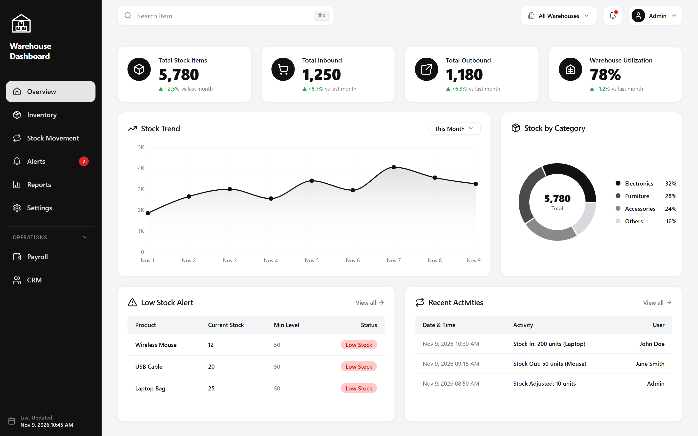

# Warehouse Dashboard (WMS)

A production-grade, multi-warehouse management web application built with **Next.js 14 (App Router)**, **TypeScript (strict)**, **Tailwind CSS**, and **Supabase (PostgreSQL + RLS)**. Designed with a clean, monochrome SaaS aesthetic where colour is used strictly for meaning (green = positive delta, red = alert/low stock).



---

## 🌟 Key Features

- **Pixel-Accurate SaaS Shell & Design System:**
  - Near-black `#111111` sidebar with outline warehouse gable logo and `#E5E5E5` active pills.
  - Generous whitespace, cards with `14px` border radius, `#EEF0F2` borders, and subtle elevation.
  - Recharts monochrome visualization palette (`#111111`, `#4B4B4B`, `#8A8A8A`, `#D9D9DE`).
  - Adaptive responsiveness across Desktop (1440px), Tablet (1024px icon-only collapse), and Mobile (390px off-canvas drawer).

- **Multi-Warehouse Tenancy:**
  - Multi-facility switching from top bar with persistent selection scoping all metrics, tables, and alerts.
  - Multi-tier tenancy: `Organization → Warehouses → Zones → Bins`.
  - Realistic seed engine with 3 facilities: Lagos Central Hub, Ikeja Logistics Depot, and Abuja Regional Facility.

- **Immutable Stock Movement Ledger:**
  - Real-time audit and movement logging (Inbound, Outbound, Inter-warehouse Transfers, Adjustments).
  - Derived inventory balances preventing negative stock states.
  - Audit trail tracking user actions, entity types, and timestamps.

- **Pre-Configured Regional Compliance (Nigeria Preset):**
  - Configurable statutory deductions (PAYE tax, 8% employee Pension, 2.5% NHF).
  - Multi-currency support (NGN default `₦`, USD `$`, EUR `€`).

---

## 🏗️ Tech Stack

- **Framework:** [Next.js 14](https://nextjs.org/) (App Router, React 18)
- **Language:** TypeScript 5 (Strict mode)
- **Styling:** [Tailwind CSS](https://tailwindcss.com/)
- **Icons:** [Lucide React](https://lucide.dev/)
- **Charts:** [Recharts](https://recharts.org/)
- **Data Tables:** [TanStack Table v8](https://tanstack.com/table/v8)
- **Validation:** [Zod](https://zod.dev/) & React Hook Form
- **Database & Auth:** [Supabase](https://supabase.com/) (PostgreSQL, Row Level Security, Realtime)

---

## 🚀 Getting Started

### 1. Clone & Install Dependencies
```bash
git clone https://github.com/Oluwataye/Bayline-.git
cd Bayline-
npm install
```

### 2. Configure Environment Variables
Copy the template file to `.env.local`:
```bash
cp .env.example .env.local
```

### 3. Run Development Server
```bash
npm run dev
```
Open [http://localhost:3000](http://localhost:3000) to view the dashboard.

### 4. Production Build & Type Check
```bash
npm run type-check
npm run build
npm start
```

---

## 📁 Project Structure

```
├── public/                 # Static assets
├── scripts/                # Automated testing & screenshot scripts
├── src/
│   ├── app/                # Next.js 14 App Router routes
│   │   ├── alerts/         # Alerts & threshold notifications
│   │   ├── crm/            # Sales pipeline & customer management
│   │   ├── inventory/      # Product catalogue & bin allocation
│   │   ├── movements/      # Stock movement & ledger timeline
│   │   ├── payroll/        # Payroll runs & statutory remittances
│   │   ├── reports/        # Valuation, ABC & operational reports
│   │   ├── settings/       # Facilities, RBAC & system configuration
│   │   ├── layout.tsx      # Root layout with responsive shell
│   │   └── page.tsx        # Overview / Dashboard widgets
│   ├── components/
│   │   ├── dashboard/      # KPI cards, Area trend & Donut charts, Tables
│   │   └── layout/         # Sidebar, TopBar, and WarehouseLogo
│   ├── config/             # Configurable app name and currency constants
│   ├── context/            # Multi-facility state & filter context
│   ├── lib/                # Utilities, formatting, and demo seed data
│   ├── styles/             # Global CSS and design tokens
│   └── types/              # Strict TypeScript domain interfaces
├── supabase/
│   ├── migrations/         # PostgreSQL schema, triggers, and RLS policies
│   └── seed.sql            # Seed dataset for demo facilities & items
└── tasks/                  # Master implementation plan & screenshots
```

---

## 📄 License
MIT

